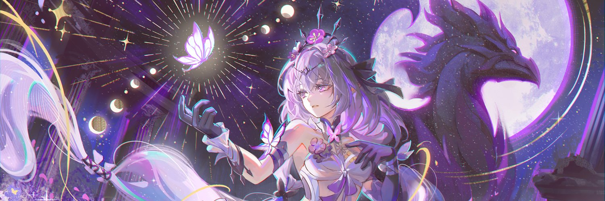

  

<h1 align="center">
  ✦ 𝑾𝒆𝒍𝒄𝒐𝒎𝒆 𝒕𝒐 𝒎𝒚 𝒘𝒐𝒓𝒍𝒅 ✦
</h1>

  

   💜 𝑮𝒊𝒔𝒆𝒍𝒍 𝑨𝒏𝒅𝒓𝒆𝒂 𝑭𝒂𝒍𝒄ó𝒏 𝑹𝒐𝒔𝒂𝒍𝒆𝒔 💜

<h3 align="center">
  💻 Systems Engineering Student
   
  📊 Aspiring Data Analyst
</h3>

  ☾ ⋆⁺₊✧ Anime · Manga · Technology · Data · Creative ✧₊⁺⋆ ☽

  

## 🌙 Sobre mí

¡Hola! Soy Gisell Andrea, estudiante de cuarto semestre de Ingeniería de Sistemas en la Universidad de la Costa (CUC), en Barranquilla, Colombia.

Me considero una persona curiosa, creativa, risueña, reservada y determinada. Me gusta aprender cosas nuevas, explorar diferentes áreas del conocimiento y vivir experiencias que me permitan crecer tanto personal como profesionalmente.

Mi formación académica y experiencia laboral abarcan áreas como la contabilidad, la logística, la administración y la tecnología. Me interesa descubrir cómo estos conocimientos pueden complementarse mediante el análisis de datos, la innovación y las estrategias empresariales.

Creo que los grandes logros comienzan con pequeños pasos y que siempre hay algo nuevo por aprender. ✨

## 🎓 Formación académica

- 💻 **Ingeniería de Sistemas:** Estudiante de cuarto semestre en la Universidad de la Costa (CUC).
- 📦 **Tecnología en Coordinación de Procesos Logísticos:** Próxima a graduarme.
- 🧾 **Técnica Auxiliar Contable:** Formación técnica en contabilidad.

## 💼 Experiencia laboral

Actualmente trabajo en la **Universidad de la Costa (CUC)**, en el área de:

**Auxiliar II – Vicerrectoría Administrativa (Vice-administrativa).**

Esta experiencia me ha permitido conocer y participar en procesos administrativos de una institución universitaria, fortalecer mis habilidades de organización, responsabilidad, gestión y trabajo en equipo.

También me ha permitido adquirir experiencia en el entorno laboral y comprender la importancia de los procesos administrativos para el funcionamiento de una organización.

## 💻 Tecnología y herramientas

Me interesa especialmente el mundo de los datos, la inteligencia artificial y la tecnología aplicada a los negocios.

### Programación y datos

  

### Desarrollo y herramientas

  

### Áreas de interés

📊 Análisis de datos.

🗄️ SQL y gestión de bases de datos.

📈 Power BI y visualización de información.

🤖 Inteligencia Artificial.

💡 Inteligencia de Negocios.

🔍 Interpretación de datos.

## 🛠️ Proyectos destacados

Estos son algunos de los proyectos y trabajos académicos que hacen parte de mi proceso de aprendizaje.

### 🚗 ParkFácil

  Proyecto colaborativo de desarrollo de software enfocado en la gestión de estacionamientos.
  
  Pruebas de extremo a extremo con Playwright.
  
  Automatización de pruebas mediante GitHub Actions.
  
  Aseguramiento de la calidad del software.
  
  Desarrollo colaborativo utilizando Git y GitHub.

## 📊 Mis intereses profesionales

Me gustaría desarrollar una carrera profesional donde se complementen la tecnología, los datos, la creatividad y los negocios.

Mis principales áreas de interés son:

| Área | Mi interés |
|---|---|
| 📈 Ciencia de Datos | Analizar información, encontrar patrones y generar conocimiento. |
| 🤖 Inteligencia Artificial | Explorar soluciones innovadoras mediante la IA. |
| 💻 Tecnología | Descubrir herramientas y nuevas posibilidades. |
| 📊 Inteligencia de Negocios | Transformar datos en decisiones estratégicas. |
| 👑 Liderazgo | Dirigir proyectos, equipos y áreas de trabajo. |
| 💄 Moda y Belleza | Integrar tecnología y análisis de datos en esta industria. |

## 🚀 Mis proyectos y sueños

Mi objetivo es desarrollarme profesionalmente en el área de Análisis de Datos e Inteligencia Artificial, combinando los conocimientos tecnológicos con la comprensión de los negocios.

Me imagino trabajando en una compañía donde pueda utilizar los datos para comprender mejor a las personas, identificar tendencias, mejorar estrategias y contribuir a la toma de decisiones.

A futuro, me gustaría liderar un departamento de Datos e Inteligencia Artificial en la industria de la moda o la belleza, integrando tecnología, creatividad y estrategias empresariales.

## 🌱 Actualmente estoy trabajando en:

- Fortalecer mis conocimientos en Python y SQL.
- Aprender sobre Power BI y visualización de datos.
- Mejorar mis habilidades analíticas y de resolución de problemas.
- Desarrollar mis capacidades de liderazgo y comunicación.
- Aprender más sobre Inteligencia Artificial e Inteligencia de Negocios.
- Crear proyectos prácticos y adquirir experiencia profesional.

## 🎨 Mis gustos y hobbies

La tecnología no es lo único que me apasiona. También tengo muchos intereses que hacen parte de mi personalidad y de mi forma de ver el mundo.

- 📚 **Mangas y mmanhwas** Amo leer mangas y mmanhwas para descubrir nuevas historias, personajes y universos.
- 🍥 **Anime:** Me encanta ver anime y explorar diferentes géneros, estilos de animación e historias.
- 🎨 **Pintura:** Me gusta pintar y expresar mi creatividad a través del arte.
- 💄 **Moda y maquillaje:** Me apasiona el mundo de la belleza, las tendencias, los estilos y todo lo relacionado con el maquillaje.
- 💃 **Baile:** Me encanta bailar, especialmente disfrutar de la música, las presentaciones y el Carnaval de Barranquilla.
- 🌌 **Astrología y mundo místico:** Me llaman la atención las energías, la astrología, la física y los temas relacionados con lo desconocido.
- ✨ **Nuevas experiencias:** Disfruto conocer cosas diferentes, salir de mi zona de confort y descubrir nuevos intereses.

---

  💜 Gracias por visitar mi perfil. ¡Siempre hay algo nuevo por aprender!

  

<h2 align="center">💌 Contact Me</h2>

  
  

  ☾ ⋆⁺₊✧ Let's connect and create something amazing! ✧₊⁺⋆ ☽

